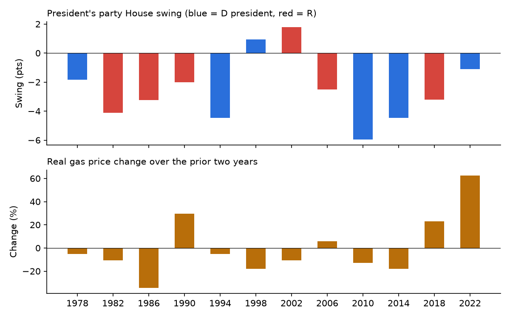
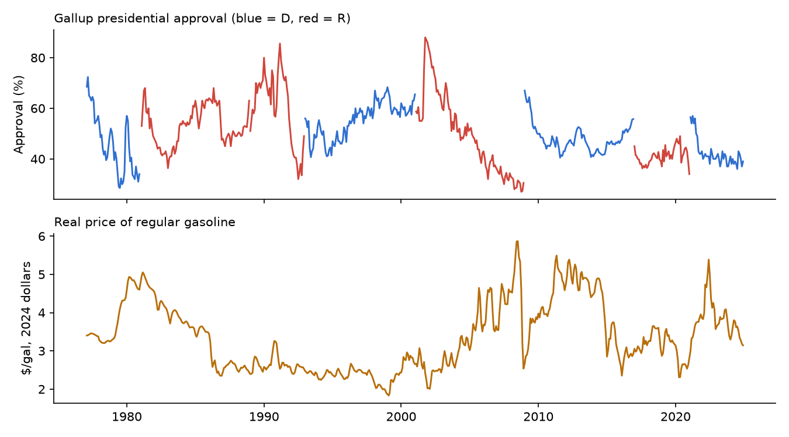

# Do High Gas Prices Sink the President's Party?

An empirical test of a common political claim: that rising gas prices cost the
president's party in U.S. midterm elections. The project uses 46 years of
public data (12 midterms, 1978–2022) at both the national and state level.

**Answer: only a little, and only through approval.** Gas prices clearly pull down
presidential approval: about −2 points per 10% real rise, measured over 574 months of
Gallup polls. Approval in turn drives midterms. But following that chain, a 20% gas spike
costs the president's party only about 0.7 points of House vote, small next to a typical
3-point midterm loss. There's no robust *direct* gas effect beyond approval, nationally or
comparing states within the same election.



## Findings

| | Result |
|---|---|
| Gas price change vs. swing (national, n = 12) | r = 0.16, slope not significant (p = 0.38) |
| Presidential approval vs. swing | r = 0.60, the strongest single predictor |
| Gas → approval (574 months, president fixed effects) | 10% real gas rise ≈ −2.0 approval points (p < 0.001) |
| How fast | approval dips within 1 month (−1.4, p = 0.005), then fades over ~a year |
| Who reacts | independents most (−2.2), president's own party least (−1.1) |
| Gas → approval → swing (mediation) | 20% gas rise ≈ −0.7 pts of House vote (SE 0.3) |
| Gas, holding approval fixed | slightly *positive*, but driven by 2022 (p = 0.31 without it) |
| State panel, year fixed effects | no gas penalty in any specification |



The positive coefficient after controlling for approval is most likely a
**bad-control artifact**. If gas prices hurt the president *through* approval,
controlling for approval removes that channel, and the leftover gas coefficient
picks up whatever else happened in high-gas years. 2022, for example, had both
a gas spike and the *Dobbs* ruling.

Full regression tables: [`reports/results.md`](reports/results.md) (midterms) and
[`reports/approval_gas.md`](reports/approval_gas.md) (monthly approval).

## 2026 forecast

Made the night before the Nov 3, 2026 election and saved with a timestamp in
[`reports/forecast_2026.json`](reports/forecast_2026.json). With approval near 38% (polling
average; Gallup ended its series in Feb 2026) and real gas up 29% since 2024, the models
expect a Republican House swing of about −4 points and roughly 183 Republican seats
(80% range 156–210), short of a majority. `src/score_2026.py` scores the forecast once
results are entered in `data/manual/results_2026_prelim.csv`.

## Interactive dashboard

`dashboard/index.html` is a single self-contained file. Open it in a browser, or
host it on GitHub Pages. It includes:
- a national scatter where you choose the comparison variable (gas, approval, inflation and more)
- a state tile map and a within-year scatter for each midterm
- a coefficient plot comparing every model's gas estimate with 95% confidence intervals

## How it works

```
src/fetch_data.py          download raw data (EIA, BLS, BEA, MIT Election Lab, Gallup via UCSB)
src/build_dataset.py       clean + merge -> data/processed/{national,state_panel}.csv
src/approval_analysis.py   monthly gas -> approval models + mediation -> reports/approval_gas.md
src/analysis.py            midterm regressions, figures, reports/results.md
src/forecast_2026.py       pre-election 2026 forecast
src/score_2026.py          score the forecast against results
src/build_dashboard.py     bake results into dashboard/index.html
notebooks/analysis.ipynb  step-by-step walkthrough of the analysis
```

### Run it

```bash
python -m venv .venv
.venv\Scripts\activate          # macOS/Linux: source .venv/bin/activate
pip install -r requirements.txt
python run_all.py
```

One manual step: the MIT House file sits behind a Harvard Dataverse sign-in form.
Download `1976-2024-house.tab` from https://doi.org/10.7910/DVN/IG0UN2 into
`data/raw/`. The script tells you if it's missing.

## Data

| Variable | Source | Level |
|---|---|---|
| House election results | MIT Election Data + Science Lab, 1976–2024 | district |
| Retail gasoline price (monthly) | EIA Monthly Energy Review, Table 9.4 | national |
| Motor gasoline price (annual) | EIA State Energy Data System (SEDS) | state |
| Crude oil cost | EIA Monthly Energy Review, Table 9.1 | national |
| CPI-U, unemployment rate | BLS public API | national / state |
| Per-capita personal income | BEA SAINC1 | state |
| Presidential approval | Every Gallup poll 1977–2025, via the UCSB American Presidency Project | national (monthly) |

## Method

- **Outcome ("swing"):** change in the president's party's share of the two-party
  House vote, midterm year vs. the presidential year two years earlier. Only
  districts with both a Democrat and a Republican on the ballot count, so unopposed races don't distort the share.
- **Gas price change:** % change in the real (2024-dollar) gas price over the same two-year window.
- **National models:** OLS with robust (HC1) standard errors, adding one control at a time
  because n = 12. Includes a leave-one-out sensitivity check.
- **Monthly approval (574 months):** approval on log real gas price, with president fixed
  effects, unemployment, inflation, time in office, and rally-event dummies (Iran hostages,
  Gulf War, 9/11, Iraq). Robustness: per-president time trends, and a 12-lag model in monthly
  changes. Newey-West (HAC) standard errors. Mediation combines the monthly gas → approval
  estimate with the midterm approval → swing estimate (delta-method SE).
- **State panel (584 state-midterms):** weighted by number of districts. Pooled models
  cluster SEs by year. Fixed-effects models (year, and year + state) cluster by state.
  Robustness checks keep only mostly-contested states and drop 2022.

## Limitations

- Only 12 midterms, so national estimates are imprecise.
- SEDS state gas prices are annual averages and include Nov–Dec, after the election.
- Gas prices move mostly together nationwide, so within-year state variation is small.
- House vote totals mix in incumbency and redistricting effects. Seat counts computed
  from the data differ from official tallies by 1–2 seats in some years.
- The month-to-month model shows the approval dip fading within about a year, while the
  levels model implies a lasting effect. The truth is likely in between, so the
  0.7-point mediation estimate is closer to an upper bound.
- Correlation, not proof: gas spikes often coincide with other bad news (wars, recessions).
  The controls catch some of that, not all.

## Ideas for extending it

- Forecast the 2026 midterm out of sample (as of Nov 2, 2026, the election is tomorrow).
- Add presidential-year elections as a placebo test.
- Use county-level commuting data (miles driven) to test whether gas hits car-dependent areas harder.
- Bootstrap the mediation estimate instead of the delta method.
- Use oil supply shocks (e.g. OPEC decisions) as an instrument for gas prices, to get closer to causation.
