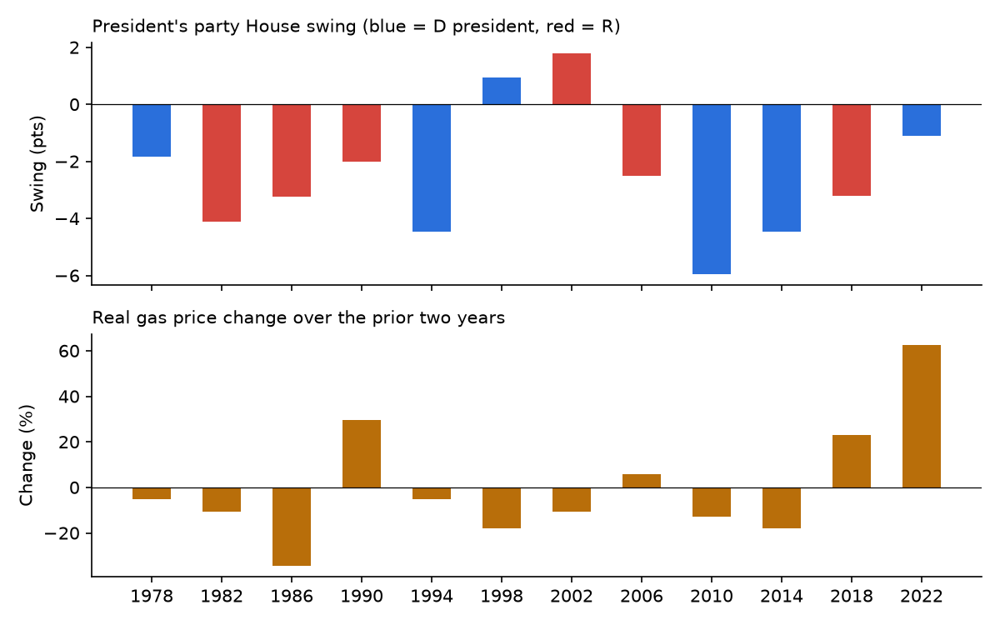
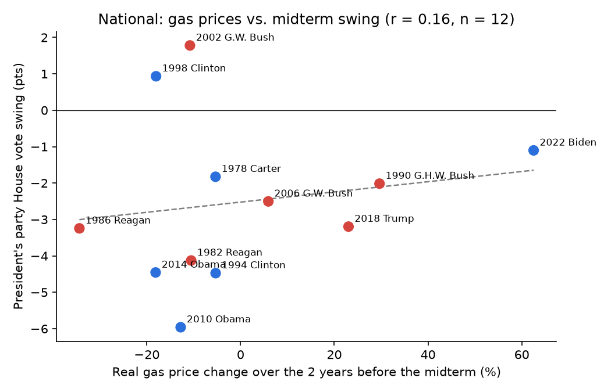
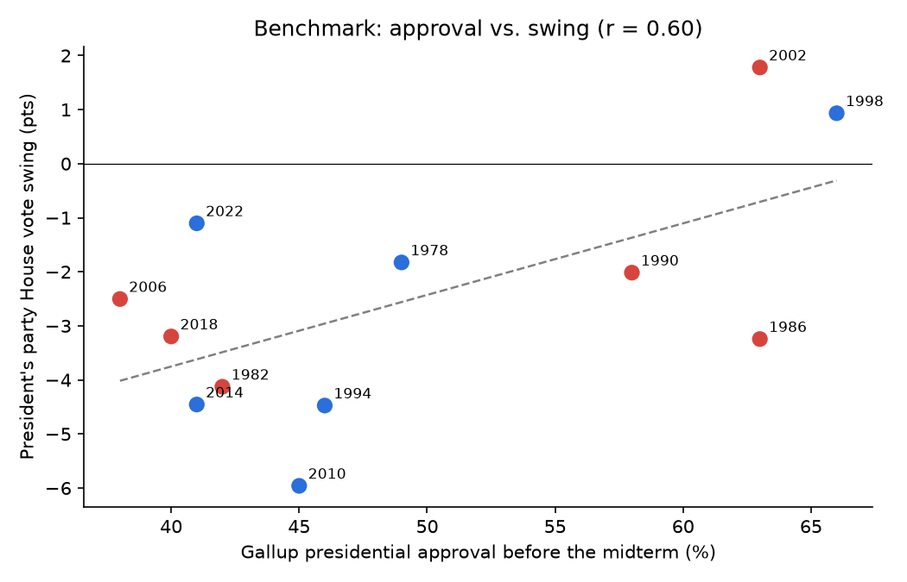
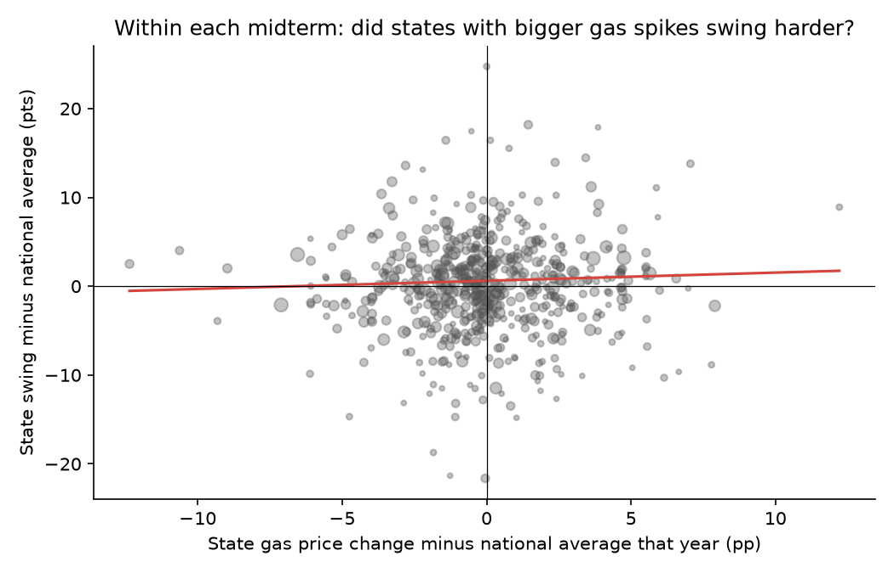

# Results: gas prices and midterm elections

Outcome = change in the president's party's two-party U.S. House vote share vs. the previous presidential election (contested districts only). Positive = gained ground.

## Key findings

**Short answer: no. In 1978–2022, rising gas prices did not reliably cost the president's
party House votes in midterms.** The usual story ("high gas prices sink the party in power")
does not show up in the data once you look carefully.

1. **On its own, the gas price change barely relates to midterm swing.** Across 12 midterms,
   r = 0.16 between the 2-year real gas price change and the president's party's
   House vote swing. Slope: +0.28 pts per 20% rise (p = 0.38). The sign is *positive*: bigger gas increases
   came with slightly *smaller* losses, the opposite of the popular story.
2. **Presidential approval dominates** (r = 0.60). On its own it explains
   36% of the variation in swing across midterms, versus
   3% for gas prices.
3. **Gas prices may work through approval.** Each 10% real gas rise is associated with
   -1.5 approval points (p = 0.09). That is the expected
   direction, but only marginally significant with n = 12.
4. **The puzzle: holding approval fixed, gas looks positive** (+0.80 pts per 20% rise (p = 0.02)).
   Treat this with caution. It depends on 2022: without 2022 it falls to
   +0.66 pts per 20% rise (p = 0.32). It vanishes when the
   1-year gas change is used instead (p = 0.67) and when seats are the
   outcome (p = 0.28). It is also a textbook *bad control* problem: if gas
   prices hurt the president *through* approval, controlling for approval strips out that channel. The
   gas coefficient then picks up whatever else happened in high-gas years. In 2022, for example, the
   *Dobbs* abortion ruling energized Democrats in the middle of a gas spike.
5. **State panel.** With national controls: +1.23 pts per 20% rise (p = 0.00). Comparing states *within the same midterm*
   (year fixed effects) asks whether states whose gas prices rose more than the national average
   swung harder against the president: +1.65 pts per 20% rise (p = 0.26). With state fixed effects as well:
   +2.67 pts per 20% rise (p = 0.09). Without 2022: +1.06 pts per 20% rise (p = 0.53). None of these show a penalty. Power is limited, because
   gas prices move mostly nationally (crude oil is a global market). Within one year, state
   gas changes differ by only about 2–5 percentage points.

**Interview-ready takeaway:** gas prices are the most visible price in the economy, but there is
no robust evidence they directly decide midterms. Any effect probably runs through presidential
approval, and with only 12 midterms the national data cannot separate gas from everything else
going on in a given year. Spotting the bad-control issue and the 2022 sensitivity is the kind of
critical thinking analyst interviews look for.

## National regressions (one row per midterm)

| | (1) Gas only | (2) + Approval | (3) + Inflation | (4) + Unemployment |
|---|---|---|---|---|
| Real gas price change, 2 yrs (%) | 0.014 | 0.040** | 0.040** | 0.035* |
| | (0.016) | (0.018) | (0.019) | (0.021) |
| Presidential approval (%) |  | 0.173*** | 0.173*** | 0.174*** |
| |  | (0.061) | (0.064) | (0.063) |
| CPI inflation, 12 mo (%) |  |  | -0.001 |  |
| |  |  | (0.185) |  |
| Unemployment change, 2 yrs (pp) |  |  |  | -0.217 |
| |  |  |  | (0.317) |
| Constant | -2.523*** | -11.046*** | -11.043*** | -11.173*** |
| | (0.681) | (2.843) | (3.104) | (2.888) |
| Observations | 12 | 12 | 12 | 12 |
| R² | 0.03 | 0.55 | 0.55 | 0.57 |

_Robust (HC1) standard errors in parentheses. * p<0.1, ** p<0.05, *** p<0.01._  
_With n = 12 these are descriptive; treat p-values with caution._  

## State panel regressions (state × midterm)

| | (1) Pooled | (2) + Controls | (3) Year FE | (4) Year + State FE | (5) Year FE, contested | (6) Year FE, no 2022 |
|---|---|---|---|---|---|---|
| Real gas price change, 2 yrs (%) | 0.011 | 0.061*** | 0.083 | 0.133* | 0.072 | 0.053 |
| | (0.019) | (0.020) | (0.073) | (0.078) | (0.064) | (0.085) |
| Presidential approval (%) |  | 0.218*** |  |  |  |  |
| |  | (0.058) |  |  |  |  |
| CPI inflation, 12 mo (%) |  | 0.015 |  |  |  |  |
| |  | (0.152) |  |  |  |  |
| Unemployment change, 2 yrs (pp) |  | 0.028 | 0.180 | 0.271 | 0.305 | -0.009 |
| |  | (0.144) | (0.218) | (0.247) | (0.192) | (0.259) |
| Real income growth, 2 yrs (%) |  | 0.003 | -0.179 | -0.163 | -0.068 | -0.231* |
| |  | (0.131) | (0.118) | (0.129) | (0.115) | (0.124) |
| Observations | 584 | 584 | 584 | 584 | 496 | 536 |
| R² | 0.00 | 0.13 | 0.20 | 0.27 | 0.24 | 0.20 |
| Fixed effects | none | none | year | year + state | year | year |

_Weighted by number of House districts. Models 1–2: SEs clustered by year (national variables vary only by year). Models 3–5: SEs clustered by state._  
_Model 5 keeps only state-years where ≥75% of districts had both a D and an R candidate. Model 6 drops 2022._  
_* p<0.1, ** p<0.05, *** p<0.01._  

## Leave-one-out: gas coefficient in model (2), dropping one midterm at a time

| Dropped | Gas coef. | p |
|---|---|---|
| 1978 | 0.041 | 0.02 |
| 1982 | 0.041 | 0.04 |
| 1986 | 0.032 | 0.11 |
| 1990 | 0.060 | 0.00 |
| 1994 | 0.038 | 0.04 |
| 1998 | 0.041 | 0.01 |
| 2002 | 0.039 | 0.00 |
| 2006 | 0.042 | 0.03 |
| 2010 | 0.033 | 0.06 |
| 2014 | 0.042 | 0.06 |
| 2018 | 0.040 | 0.03 |
| 2022 | 0.033 | 0.32 |

## Correlations with national swing

| Variable | r |
|---|---|
| Real gas price change, 2 yrs (%) | 0.16 |
| Real gas price change, 1 yr (%) | 0.00 |
| Real crude oil change, 2 yrs (%) | 0.03 |
| Presidential approval (%) | 0.60 |
| CPI inflation, 12 mo (%) | 0.16 |
| Unemployment change, 2 yrs (pp) | -0.18 |

## Figures

